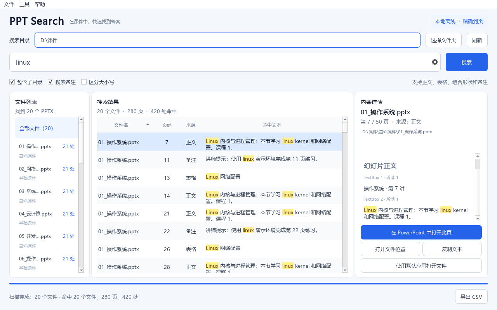

# PPT Search · Windows 幻灯片全文搜索

选择文件夹，输入 `linux`，一次查找所有 PPTX，显示 **文件名＋实际页码＋命中文本**。双击结果在 PowerPoint 中打开对应页。搜索过程完全离线。

**[下载 Windows 便携版](https://github.com/ddddddavid66/ppt-search/releases/download/v1.0.0/PPTSearch-1.0.0-win64.zip)** · **[全部 Release](https://github.com/ddddddavid66/ppt-search/releases)** · **[下载源码](https://github.com/ddddddavid66/ppt-search/releases/download/v1.0.0/PPTSearch-1.0.0-source.zip)**



## 功能

- 递归搜索文件夹，支持中文、英文和完整短语，关键词高亮。
- 按文件筛选结果，查看整页提取文字和上下文，双击跳转原幻灯片。
- 搜索正文、表格、嵌套组合形状和讲者备注，支持跨字体或颜色的连续文字。
- 按实际排列顺序计页，包含隐藏页；重排后的课件仍可准确定位。
- SQLite 增量缓存，后台搜索可取消，单个文件读取失败不影响其他课件。
- 复制命中文本，导出 Excel 可直接查看的中文 CSV。
- 完全离线，不上传课件，不下载模型，无须安装 Python 即可使用便携版。

搜索 `linux` 的结果示例：

| 文件名 | 实际页码 | 来源 | 命中文本 |
| --- | ---: | --- | --- |
| 操作系统.pptx | 8 | 正文 | Linux 内核与进程管理…… |
| 操作系统.pptx | 15 | 表格 | Linux 网络配置 |
| 网络基础.pptx | 12 | 备注 | 使用 linux 演示环境完成练习…… |

## 使用便携版

1. 从 [Releases](https://github.com/ddddddavid66/ppt-search/releases/latest) 下载 `PPTSearch-1.0.0-win64.zip`，解压到可写目录。保留整个 `PPTSearch` 文件夹，不能单独移动 EXE。
2. 双击 `PPTSearch.exe`，选择存放课件的文件夹，或直接把文件夹拖入窗口。
3. 输入关键词并按 Enter。默认包含子目录、正文、表格、组合形状和讲者备注，不区分大小写。
4. 左侧按文件筛选，中间选择结果，右侧查看整页提取文字和高亮。双击结果或点击“在 PowerPoint 中打开此页”。
5. “导出 CSV”导出当前文件筛选下的全部结果；CSV 使用 UTF-8 BOM，可用 Excel 打开。

快捷键：`Ctrl+O` 选择目录，`Ctrl+F` 聚焦搜索，`F5` 刷新，`Esc` 取消。搜索期间按钮变为取消；按 Enter 可提交新查询，旧任务结果会被丢弃。

支持 Windows 10/11 64 位。运行便携版不需要 Python，搜索也不需要 Office；准确跳转原页需要 Microsoft PowerPoint。WPS 可通过默认应用打开文件，但首版不保证跳转页码。没有 PowerPoint 或自动化失败时，搜索结果仍可用。

## 页码与搜索范围

- 页码从 1 开始，等于 PowerPoint 左侧缩略图中的实际顺序，包含隐藏页并标注；不是页脚自定义编号或内部 XML 文件编号。
- 每个命中段落一行，同段多次命中合并展示；统计“处”是关键词出现次数，“页”按文件和幻灯片去重。
- 支持标题、文本框、嵌套组合形状、表格和讲者备注；同段跨字体/颜色的格式片段会合并后匹配。匹配完整短语时直接输入短语，无须引号。按字面搜索，不把输入解释为正则表达式。
- 读取磁盘上已保存版本，未保存修改需要在 PowerPoint 中先保存再刷新。若已打开文稿只调整了顺序，稳定幻灯片 ID 仍能定位该页。
- 首版不识别图片文字，不读取 SmartArt 内部文字、图表内部数据、嵌入附件、母版/版式继承的文字，不处理旧 `.ppt`，不支持密码解密，也不提供原页图片预览。不同文本框或段落之间不拼接为一个长词。
- 无法读取的文件单独列出，不影响其他课件；跳过 `~$` 临时文件。程序不保存、不转换、不关闭用户文稿，新打开的演示文稿为只读模式。

## 本地数据

`data` 位于程序旁边，保存 SQLite 文本缓存、目录和选项设置、滚动日志。缓存包含从课件提取的原文。文件大小或修改时间变化时重新提取；删除的文件在下一次搜索清理。工具菜单可清除文本缓存，也可打开数据目录。

第一次启动默认选择程序所在目录，此后记住上次目录。也可将目录作为启动参数：

```powershell
.\PPTSearch.exe 'D:\我的课件'
```

## 从源码运行

需要 Python 3.11 64 位和 Git。核心依赖为 python-pptx 1.0.2、PySide6 Essentials 6.8.3、pywin32；只安装 Qt Core/Gui/Widgets 等必需组件，减少体积。运行、测试和构建的依赖版本记录在 `requirements-lock.txt`。

```powershell
git clone https://github.com/ddddddavid66/ppt-search.git
cd ppt-search
python -m venv .venv
.\.venv\Scripts\python.exe -m pip install -r requirements-lock.txt
.\.venv\Scripts\python.exe main.py
```

`ppt_search` 分离数据结构、提取、缓存、检索、Qt 工作线程、展示模型和 PowerPoint 集成。GUI 线程不读取课件或执行 COM；每个任务有独立取消事件、SQLite 连接和任务编号。

## 验证与构建

```powershell
.\.venv\Scripts\python.exe -m pytest -q
.\.venv\Scripts\python.exe -m tools.make_demo --output work\demo
.\.venv\Scripts\python.exe -m tools.acceptance --root work\demo --office
.\build.ps1
```

样本生成器生成 20 份、1,000 页课件及独立的预期命中清单。验收脚本检查冷/热搜索、GUI 展示、复制和截图；加 `--office` 验证本机只读打开、原页跳转、窗口复用和源文件未变化。该测试只关闭自行生成并打开的测试课件。

`build.ps1` 使用现有虚拟环境；首次构建或重装环境可运行 `build.ps1 -InstallDependencies`。构建结果在 `outputs`：便携文件夹、ZIP、源码 ZIP，以及已有的验收数据和界面截图。运行测试与截图时使用正常 Windows 平台；无桌面的 CI 可设置 `QT_QPA_PLATFORM=offscreen`，但该模式的字体截图不代表 Windows 实际效果。

发布前回归 **11 项测试通过**。固定样本为 20 份、共 1,000 页；搜索 `linux` 对应 280 个命中段落、420 处出现，与独立预期清单逐条比对一致。本机此前测量：首次搜索约 1.44 秒，缓存搜索约 0.04 秒，原生 GUI 后续缓存查询并展示约 0.39 秒。实际耗时取决于课件复杂度、磁盘和机器配置。

## 项目结构

```text
ppt_search/           提取、搜索、缓存、Qt 界面与 PowerPoint 集成
tests/                内容、页码、缓存、GUI 和任务隔离测试
tools/                样本生成、验收、打包工具
docs/                 界面截图和版本记录
licenses/             Qt 许可证原文
main.py               桌面入口
build.ps1             Windows 构建入口
requirements-lock.txt 依赖版本锁定
```

虚拟环境、课件样本、日志、缓存和构建产物不提交到 Git。Windows 便携版通过 Release 分发，源码包与对应 Git 标签一致。

## 开源基础

- [python-pptx](https://github.com/scanny/python-pptx)：PPTX 解析核心，MIT。
- [Qt for Python / PySide6](https://www.qt.io/qt-for-python)：中文桌面界面，按 Qt 提供的开源许可证使用。Qt DLL 在便携包中动态分发，可替换兼容版本。
- [pywin32](https://github.com/mhammond/pywin32)：Windows COM。
- [PyInstaller](https://pyinstaller.org/)：Windows 便携打包。

本项目代码采用 MIT；第三方依赖分别适用各自许可证。便携包 `THIRD_PARTY_LICENSES` 和 `THIRD_PARTY_NOTICES.md` 包含依赖原始许可及 Qt 对应源码获取信息。

版本记录见 [v1.0.0](docs/releases/v1.0.0.md)。问题反馈请到 [Issues](https://github.com/ddddddavid66/ppt-search/issues)，说明软件版本、Windows/PowerPoint 版本和复现步骤；请勿上传含敏感内容的课件或缓存。
